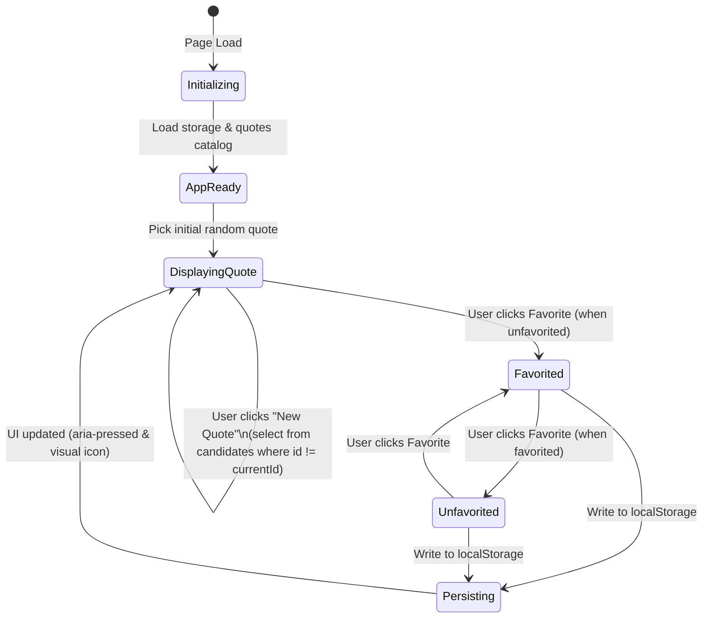

# Data Model: Quote of the Day Web App

**Feature**: Quote of the Day Web App  
**Spec Reference**: [`specs/001-quote-of-the-day/spec.md`](file:///Users/berfin/spec-kit-week2/specs/001-quote-of-the-day/spec.md)  
**Plan Reference**: [`specs/001-quote-of-the-day/plan.md`](file:///Users/berfin/spec-kit-week2/specs/001-quote-of-the-day/plan.md)  

---

## 1. Core Entities

### 1.1 `Quote` Entity
Represents an inspirational quotation in the built-in catalog.

| Field | Type | Description | Validation Rules |
| :--- | :--- | :--- | :--- |
| `id` | `number` | Unique numeric identifier for the quote. | Required, positive integer, strictly unique across catalog. |
| `text` | `string` | The quotation body text. | Required, non-empty, trimmed, min 5 chars. |
| `author` | `string` | The attributed author of the quote. | Required, non-empty, trimmed, min 2 chars. |

```javascript
// Example JavaScript Quote Object representation:
{
  id: 1,
  text: "Simplicity is the soul of efficiency.",
  author: "Austin Freeman"
}
```

---

### 1.2 `FavoriteState` Entity
Represents persistent client-side bookmarks of quotes favorited by the user.

| Field | In-Memory Representation | Storage Representation | Description |
| :--- | :--- | :--- | :--- |
| `favoriteIds` | `Set<number>` | `string` (JSON array: `[1, 4, 7]`) | Set of quote `id` values marked as favorites. |
| `storageKey` | Constant string | `"quote_of_the_day_favorites"` | The key under which favorite IDs are saved in `localStorage`. |

---

### 1.3 `AppState` (Runtime View Model)
Tracks the active application runtime state in `script.js`.

| Property | Type | Default | Description |
| :--- | :--- | :--- | :--- |
| `quotes` | `Array<Quote>` | Array of 10+ quotes | Static, immutable catalog of quotes. |
| `currentQuote` | `Quote \| null` | `null` | The quote currently rendered in the UI. |
| `favoriteIds` | `Set<number>` | `new Set()` | Active set of favorited quote IDs. |
| `storageAvailable` | `boolean` | `true` | Indicates whether `localStorage` is accessible and writable. |

---

## 2. State Lifecycle & Transitions



### 2.1 Transition Specifications

1. **Initialization (`onInit`)**:
   - Tests availability of `localStorage`.
   - Reads `"quote_of_the_day_favorites"` and populates in-memory `favoriteIds` `Set`.
   - Selects an initial quote randomly from `quotes`.
   - Calls `renderQuote(currentQuote)` and `updateFavoriteUI(isFavorited)`.

2. **New Quote Request (`onNewQuote`)**:
   - Input: Current `currentQuote.id`.
   - Candidate pool: `quotes.filter(q => q.id !== currentQuote.id)`.
   - Selection: Random index from candidates pool.
   - Result: `currentQuote` updated to candidate.
   - Favorite state refreshed: `favoriteIds.has(currentQuote.id)`.
   - DOM updated with new quote and synchronized favorite button state.

3. **Favorite Toggle (`onToggleFavorite`)**:
   - Input: Current `currentQuote.id`.
   - Action:
     - If `favoriteIds.has(id)`: remove `id` from Set (`favoriteIds.delete(id)`).
     - Else: add `id` to Set (`favoriteIds.add(id)`).
   - Persistence: Serialize `Array.from(favoriteIds)` to JSON and write to `localStorage`.
   - UI Update: Update button `aria-pressed`, button icon, and label state.

---

## 3. Data Integrity & Validation Rules

- **Catalog Completeness**: The catalog MUST contain at least 10 entries ($\text{length} \ge 10$).
- **ID Uniqueness**: Every quote ID MUST be unique within the catalog array.
- **Defensive Storage Deserialization**:
  - If `localStorage` contains corrupt or non-array JSON, reset gracefully to an empty array without crashing.
  - Filter out any non-numeric or unknown IDs not present in `quotes`.
- **Storage Degradation**:
  - If `localStorage` read or write fails (`QuotaExceededError` or `SecurityError`), the app maintains favorite state in-memory for the active session.
